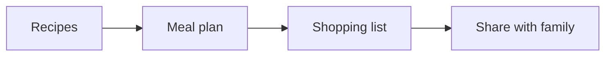

# Recipe app: project plan

A small app that lets people save recipes, plan the week's meals and get one shopping list.

> [!TIP]
> Start with [Phase 1](phase-1-design/README.md). Words we use are in the [glossary](GLOSSARY.md).

## Phases

| Phase | Folder | What ships |
| --- | --- | --- |
| 1 | [Design](phase-1-design/README.md) | Screens, user research, the data model |
| 2 | [Build](phase-2-build/README.md) | The app, sign-in, sync, the shopping list |

## How the pieces fit

## Done when

- [x] Plan written
- [x] Phases agreed
- [ ] Phase 1 started
